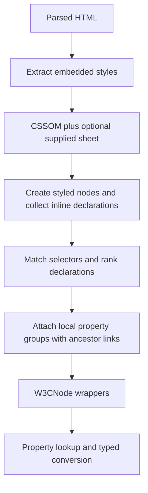

# Architecture and scope

## Intent

The package documentation describes HTMLBook as the document representation for
print and digital typesetting. The implemented responsibility is narrower: adapt
parsed HTML into a navigable tree with CSS property groups and convenient typed
values. Layout, line breaking, pagination, font resolution, and PDF rendering are
outside this module. There is no HTMLBook-specific validator here.

## Package inventory

| Package / files | Responsibility | Current boundaries |
| --- | --- | --- |
| `dom` (`dom.go`, `actions.go`) | W3C-like wrappers, navigation, attributes, text, style access, construction | Read-oriented subset; wrappers expose underlying mutable styled nodes |
| `w3cdom` | Interfaces for nodes, attributes, lists, computed styles | Not a complete browser DOM API |
| `styledtree` | Connect generic tree nodes, HTML nodes, and property maps | Concrete implementation; old builder abstractions remain in comments |
| `style` | Raw string properties, grouped maps, defaults, shorthand expansion, colors | Shared registry of groups, initial values, and inheritance |
| `style/cssom` | Sheet registration, selector matching, declaration ranking, styled-tree construction | Cascadia selectors; cached compiled selectors; subtree scopes; partial origin handling |
| `style/cssom/douceuradapter` | Adapt douceur rules and extract embedded sheets | No external stylesheet fetching; extraction tolerates missing head/body and skips empty style elements |
| `style/css` | Property retrieval and dimension, position, display helpers | Resolves inherit/initial/unset; relative lengths remain unresolved |
| `dimen` | Fixed-point units, points, rectangles, parsing | `DU` is `int32`; 65,536 units per big point; `PX = IN/96`, `PT = BP = IN/72` |
| `domdbg` | DOT export and optional GraphViz SVG generation | Debug utility; `Dotty` needs the external `dot` program |

The repository also contains a license, sample/generated DOT and SVG files, and
`style/css/option.go.refact`. The latter is historical source, not compiled Go.

## Construction and lookup



`dom.FromHTMLParseTree` extracts embedded sheets, registers the optional sheet,
and calls `CSSOM.Style`. The CSSOM creates a synthetic root carrying defaults and
a document child referencing the same HTML node. The returned tree starts at that
document child; its parent is the synthetic root. This distinction matters when
traversing upwards and when deciding whether a node is a document or a root.

Construction and styling use two tree-walker passes with a synchronization boundary.
Element and text nodes are retained; style elements, comments, and doctypes are not
represented in the resulting tree. Styling uses an element-name allowlist, so a
retained node is not necessarily styled by matching rules.

Property maps contain local declarations, not a flattened computed-style snapshot.
A nil map is normal for a node without local declarations. Property groups have
parent links for lookup and can be shared. `Styles()` exposes these mutable maps.
The `ComputedStyles` wrapper asks `css.GetProperty` to resolve values; on a returned
error it returns `NullStyle`. `StyNode.GetPropertyValue` is the shared resolver for inheritance and defaults.
Neither path establishes full layout-dependent computed-value semantics.

Rule selection now uses the strongest selector-list branch that actually matches
the node, followed by source order when specificity ties. Tests protect this and
explicit local declarations whose values equal defaults. These are useful recent
improvements. Full origin handling is not implemented: property records are marked
`Author`, and the sorter distinguishes inline rules, importance, specificity, and
order rather than the declared `PropertySource` hierarchy.

## Build and dependency model

Contrary to `AGENTS.md`, this checkout has `go.mod` and `go.sum`, declares Go 1.25.6,
and has multiple commits. It depends on Cascadia, douceur, schuko, tree, and
`golang.org/x/net`, plus indirect dependencies. The old claim that Cascadia is the
only nonstandard dependency is stale.

```sh
go test ./... -cover
go vet ./...
```

The checked-in replacements for `tree` and `schuko` require sibling directories
`../tree` and `../schuko` when this module is the main module. Successful checks in
this workspace do not prove a standalone clone builds. A reproducible release
should use published dependency versions or document a workspace setup and exact
sibling revisions. Consumers do not inherit another module's replacement directives.

## API expectations to make explicit

- Decide which nil receivers, empty maps, and detached nodes are valid inputs.
- Separate local declarations, inherited values, defaults, and resolved values.
- Document the synthetic root and whether node lists are snapshots. `ChildNodes`
  currently builds a slice despite its comment promising a live list.
- Define ownership of exposed maps and groups. `sync.Map` in the rules registry
  does not make property mutation or the entire API safe for concurrent use.
- Define the supported property/value subset, extension behavior, and diagnostics
  for unsupported input. Silent fallback is currently common.

## Registering custom shorthands

Assign `engine := cssom.NewCSSOM(nil)`, call
`engine.RegisterCompoundSplitter(splitter)`, then call `engine.Style(htmlTree)`.
Registration now mutates the engine via a pointer receiver. Nil splitters are
ignored; built-ins take precedence, followed by custom splitters in registration
order. Return an error for an unhandled property so later splitters can try it.
Register all splitters before styling; registration and styling are not synchronized.

## Stylesheet scopes

`AddStylesForScope(element, sheet, source)` applies a sheet to that HTML element
and all its descendants. A nil scope is document-wide. Sheets are considered in
this order: global, outer ancestor scopes, inner scopes, and the target element's
scope. Within each scope, registration order is preserved. Later declarations win
only when importance and specificity tie; nesting does not override either.
Inline declarations apply only to their own element. Inheritance remains a separate
property lookup operation. Selectors are evaluated against the original HTML tree;
this API does not implement CSS `@scope` selector boundaries or scoping proximity.

## Property defaulting

The registry in `style/defaults.go` supplies grouping, initial values, and implicit
inheritance. UA overrides are stored separately from initial values, so `initial`
ignores both overrides and element-specific display defaults. `inherit` resolves
the parent element's value, including that parent's own defaulting; `unset` chooses
inherit or initial according to metadata. Unknown properties do not implicitly
inherit and have no initial value. The synthetic default node is not a CSS parent.
`css.GetCascadedProperty` is a raw lookup; `css.GetProperty` performs defaulting.

The `word-wrap` alias now shares canonical `overflow-wrap` storage and metadata.
Inline and stylesheet declarations compete as one property using declaration order
and importance; both lookup names work. Property enumeration uses `overflow-wrap`.
Focused alias regressions were added on 2026-11-11.

Dimension parsing now supports signed decimal values and checked scaling with
half-away-from-zero rounding. RelativeValue exposes fractional font/viewport
magnitudes. Overflow and fractional regression tests were added (2026-11-11).

## Color conversion

`style.ParseColor` parses named, transparent, hex, rgb/rgba, hsl/hsla, and hwb
colors into `color.NRGBA`, returning errors for unsupported/context-dependent input.
`Property.Color` preserves its legacy invalid-input black fallback and nil for
`default`. `ColorString` now emits hex with alpha (or transparent/default), replacing
its old approximate named-color output and nil-to-powderblue behavior. Palette data
comes from golang.org/x/image/colornames. DOM-02 replaces registry color sentinels with black foreground (the print UA
choice), transparent background and currentcolor borders. The legacy conversion
helpers still recognize the explicit renderer sentinel for compatibility.

The Text property group includes font-family, font-size, font-weight, font-style,
and unicode-bidi. Font properties inherit; unicode-bidi does not. Generic serif is
the module's UA-selected initial family; medium and normal remain symbolic values
for downstream font resolution. Adding metadata does not implement font layout.

## Embedded stylesheet extraction

Use `douceuradapter.ExtractStyleElementsWithError` for recursive document/fragment
scanning and complete text content. It returns valid sheets plus joined parse
errors carrying source nodes. The legacy extractor discards those errors.
`dom.FromHTMLParseTreeWithError` instead aborts construction on any extraction
error; its legacy wrapper logs and returns nil. No partial DOM is returned.

## CSS source inspection (DOM-01)

`cssom.InspectStylesheet` returns source-ordered rules/declarations, structured
`Diagnostics`, and a `Sheet` for registration with `AddStylesForScope`. Inspection
preserves duplicate and invalid declarations before cascade reduction, including
raw text, importance, one-based rule/declaration ordinals and CSS line/column
locations. These positions refer to the supplied CSS, not the containing HTML.
Unsupported at-rules retain their text as opaque rules and receive diagnostics;
inspection never fetches external resources.

`cssom.InspectInlineStyle` uses the same declaration handling as permissive inline
styling. Invalid syntax and invalid values in the checked display/box subset are observable
before they are dropped. Unimplemented property grammars remain the responsibility
of later validation; a declaration's `Valid` flag does not promise complete CSS support.
Selector parsing uses the cascade engine's Cascadia parser. Strict callers must
reject any diagnostics before using the successful subset in `Sheet` or invoking
`Style`. Ordinary `Style` and the existing douceur adapter remain permissive.

The template loader in `pagelayout/template` uses this explicit reporting path.
It attaches original HTML source identities to diagnostics, checks shared sheets
once, and checks inline styles before styling isolated active documents.

## Checked box values and defaults (DOM-02)

`style.NormalizeDeclaration` validates supported values before duplicate reduction
in both inspected and legacy sheets and inline attributes, and again before
winning effective declarations enter property maps. Invalid higher-priority
values cannot erase earlier valid ones. DOM-01 retains the invalid source and
reports `css.invalid-value`. Existing four-sided edge shorthands are validated as
whole declarations and preserve function arguments. DOM-03 adds the selected
border/background shorthand forms and their reset semantics below.

The supported subset covers physical width/height/min/max sizes, insets, margins,
padding, border width/style/color, foreground/background color, simple named flows,
box sizing, writing mode, direction, position, float and visibility. Unknown
properties remain permissive. CSS-wide tokens are decoded and normalized;
`revert`/`revert-layer` remain unevaluated and checked accessors return errors.
For the DOM-02 properties, math and variable/environment functions remain opaque in the permissive cascade;
these functions are not evaluated or fully grammar-validated by this stage.
Checked accessors reject them until the required evaluation stage exists.

- `style.ParseBoxLength` and `css.GetBoxLength` distinguish absolute DU values,
  fractional percentages without clamping, relative magnitudes/units, and symbolic
  sizing keywords. Unitless zero is valid; nonzero unitless and legacy bp/sp input
  is rejected by this checked CSS API. CSS absolute units (including pc and Q)
  and decimal/exponent notation use checked `dimen.ParseAbsolute` conversion.
  Property-specific negativity is checked before rounding. Used-value resolution
  and layout are separate; DU values must be converted to CSS pixels for the
  box-layout boundary.
- `style.ParseColorValue` retains currentcolor symbolically; `css.GetColor`
  resolves it on the receiving element to non-premultiplied sRGB. On `color`
  itself, currentcolor behaves as inheritance. Elsewhere an inherited currentcolor
  keyword resolves against the recipient's foreground.
- `style.ParseFlowName` and `css.GetFlowName` decode escaped identifiers and
  preserve case. Empty means none. Reserved names are rejected. flow-from and
  flow-into do not inherit implicitly; optional flow-into modifiers are not in
  this first subset.
- `style.ParseBoxKeyword` / `css.GetBoxKeyword` check box enum values.
  box-sizing defaults to content-box and does not inherit; writing-mode defaults
  to horizontal-tb and inherits. min-width/min-height now default to auto.
- `css.GetBorder` returns each physical edge's style, sRGB color and effective DU
  width. none/hidden have zero width, including when that computed width is
  explicitly inherited by a child with a visible border. Relative nonzero widths
  need font resolution. UA keyword widths retain the existing .5/1/2px policy
  for thin/medium/thick; no device-pixel snapping is performed here.

Color defaults follow a fixed print-UA choice of black for the foreground,
transparent background and currentcolor borders. This intentionally changes raw
`GetProperty` / DOM accessor results that previously returned `default` or fixed
black border colors. `Property.Color` and `ColorString(nil)` retain their legacy
sentinel compatibility, but the checked accessors never return sentinels.

Standards consulted for these contracts: [CSS Color resolving rules](https://www.w3.org/TR/css-color-4/#resolving-other-colors),
[border width semantics](https://www.w3.org/TR/css-backgrounds-3/#border-width),
[box sizing](https://www.w3.org/TR/css-sizing-3/#box-sizing),
[custom identifiers](https://www.w3.org/TR/css-values-4/#custom-idents), and
[CSS Regions named flows](https://drafts.csswg.org/css-regions-1/#the-flow-from-property).

## Border and solid-background shorthands (DOM-03)

`style.SplitCompoundProperty` now expands `border`, the four physical side
shorthands (`border-top`, etc.), and a solid-color subset of `background`.
`NormalizeDeclaration` uses the same validator before duplicate reduction;
invalid or unsupported input produces no partial expansion. DOM-01 keeps the
original declaration and reports `css.invalid-value`, including for losing or
unmatched declarations. Permissive styling skips it and retains earlier valid
values. This replaces the previous opaque handling of these shorthand names.

- `border` and each side accept one or more of width, style and color in any
  order, with at most one of each. They reuse the checked DOM-02 grammars,
  including unitless zero, width keywords, relative lengths and color functions.
  Omitted components reset to `medium`, `none` and `currentcolor`.
- `border` also resets all five `border-image-*` longhands: source `none`, slice
  `100%`, width `1`, outset `0`, repeat `stretch`. A side shorthand only changes
  that side. Neither shorthand resets border radii.
- `background` accepts a single checked color, optionally with `none` in either
  order, or `none` alone. It resets color to `transparent`, image to `none`,
  position to `0% 0%`, size to `auto auto`, repeat to `repeat`, attachment to
  `scroll`, origin to `padding-box` and clip to `border-box`, then assigns the
  specified color. It does not reset `background-blend-mode`.

The registry includes non-inherited defaults for these reset properties. This
adds metadata, not image/background layout or validation of every corresponding
longhand. Images, gradients, multiple layers, position/size/repeat forms, and
math/substitution functions in these shorthands remain unsupported and diagnosed.
Substitution would require a pending-substitution model before resets can be
applied correctly; it is not silently approximated here.

CSS-wide keywords expand to **all** subproperties, including border-image's
reset-only properties. Existing defaulting handles `initial`, `inherit` and
`unset`; `revert`/`revert-layer` remain symbolic and checked accessors report
their missing evaluation. Every expanded longhand retains the shorthand's
importance and source order. Existing specificity and inline precedence apply.

Regressions cover grammar/reset sets, atomic rejection, checked colors/borders,
source diagnostics, and cascade behavior through inline, inspected and legacy
stylesheet routes. `pagelayout/template` also exercises the actual collection
sketch (`border: 0`, `background: #ffffff`) in isolated template documents.

The reset sets follow [CSS Backgrounds and Borders Level 3](https://www.w3.org/TR/css-backgrounds-3/);
CSS-wide and importance propagation follow [CSS Cascade's shorthand rules](https://www.w3.org/TR/css-cascade-5/#shorthand).

## CSS absolute units

All module units now use CSS definitions: 96 pixels and 72 points per inch.
`DU` stays int32, with 65,536 DU per CSS/PDF point. `PT` is now equal to `BP`;
`PX` is 49,152 DU. Both parsers share `dimen.ParseAbsolute`. Decimal mm/cm
conversion uses exact inch ratios before rounding, so 25.4mm and 2.54cm equal
one inch exactly. MM/CM constants remain nearest-DU approximations.

This intentionally changes existing px/pt results and border-width keyword sizes
expressed through PX. Downstream TeX conversions must be defined downstream.
`bp`, `sp`, and unitless-as-sp remain compatibility extensions. Parent/root-relative
length computation and viewport/font metrics are still downstream responsibilities.

HTML tag defaults now use inline fallback with explicit block/list/table/control
and non-rendered exceptions. Paragraphs use the standard block default; inline grouping belongs to layout.
This table is separate from the styling allowlist and layout capabilities; table-part values have normalized `display.InternalRole` values but do not imply table layout
support.

`css.GetDisplay` returns normalized `display.Value` values. Table parts use
Kind Internal and InternalRole; table/inline-table use explicit outer/inner
pairs. The former bitmask API has been removed.
