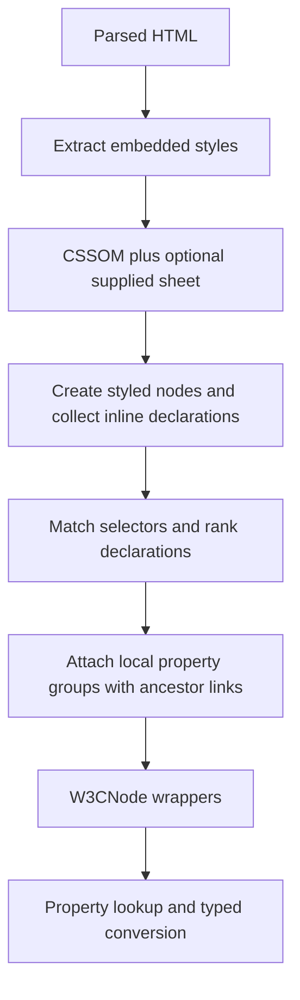

# Architecture and scope

## Intent

The package documentation describes HTMLBook as the document representation for
print and digital typesetting. The implemented responsibility is narrower: adapt
parsed HTML into a navigable tree with CSS property groups and convenient typed
values. Layout, line breaking, pagination, font resolution, and PDF rendering are
outside this module. There is no HTMLBook-specific validator here.

## Package inventory

| Package / files | Responsibility | Current boundaries |
| --- | --- | --- |
| `dom` (`dom.go`, `actions.go`) | W3C-like wrappers, navigation, attributes, text, style access, construction | Read-oriented subset; wrappers expose underlying mutable styled nodes |
| `w3cdom` | Interfaces for nodes, attributes, lists, computed styles | Not a complete browser DOM API |
| `styledtree` | Connect generic tree nodes, HTML nodes, and property maps | Concrete implementation; old builder abstractions remain in comments |
| `style` | Raw string properties, grouped maps, defaults, shorthand expansion, colors | Shared registry of groups, initial values, and inheritance |
| `style/cssom` | Sheet registration, selector matching, declaration ranking, styled-tree construction | Cascadia selectors; cached compiled selectors; subtree scopes; partial origin handling |
| `style/cssom/douceuradapter` | Adapt douceur rules and extract embedded sheets | No external stylesheet fetching; extraction tolerates missing head/body and skips empty style elements |
| `style/css` | Property retrieval and dimension, position, display helpers | Resolves inherit/initial/unset; relative lengths remain unresolved |
| `dimen` | Fixed-point units, points, rectangles, parsing | `DU` is `int32`; 65,536 units per big point; `PX` equals `BP` by local convention |
| `domdbg` | DOT export and optional GraphViz SVG generation | Debug utility; `Dotty` needs the external `dot` program |

The repository also contains a license, sample/generated DOT and SVG files, and
`style/css/option.go.refact`. The latter is historical source, not compiled Go.

## Construction and lookup



`dom.FromHTMLParseTree` extracts embedded sheets, registers the optional sheet,
and calls `CSSOM.Style`. The CSSOM creates a synthetic root carrying defaults and
a document child referencing the same HTML node. The returned tree starts at that
document child; its parent is the synthetic root. This distinction matters when
traversing upwards and when deciding whether a node is a document or a root.

Construction and styling use two tree-walker passes with a synchronization boundary.
Element and text nodes are retained; style elements, comments, and doctypes are not
represented in the resulting tree. Styling uses an element-name allowlist, so a
retained node is not necessarily styled by matching rules.

Property maps contain local declarations, not a flattened computed-style snapshot.
A nil map is normal for a node without local declarations. Property groups have
parent links for lookup and can be shared. `Styles()` exposes these mutable maps.
The `ComputedStyles` wrapper asks `css.GetProperty` to resolve values; on a returned
error it returns `NullStyle`. `StyNode.GetPropertyValue` is the shared resolver for inheritance and defaults.
Neither path establishes full layout-dependent computed-value semantics.

Rule selection now uses the strongest selector-list branch that actually matches
the node, followed by source order when specificity ties. Tests protect this and
explicit local declarations whose values equal defaults. These are useful recent
improvements. Full origin handling is not implemented: property records are marked
`Author`, and the sorter distinguishes inline rules, importance, specificity, and
order rather than the declared `PropertySource` hierarchy.

## Build and dependency model

Contrary to `AGENTS.md`, this checkout has `go.mod` and `go.sum`, declares Go 1.25.6,
and has multiple commits. It depends on Cascadia, douceur, schuko, tree, and
`golang.org/x/net`, plus indirect dependencies. The old claim that Cascadia is the
only nonstandard dependency is stale.

```sh
go test ./... -cover
go vet ./...
```

The checked-in replacements for `tree` and `schuko` require sibling directories
`../tree` and `../schuko` when this module is the main module. Successful checks in
this workspace do not prove a standalone clone builds. A reproducible release
should use published dependency versions or document a workspace setup and exact
sibling revisions. Consumers do not inherit another module's replacement directives.

## API expectations to make explicit

- Decide which nil receivers, empty maps, and detached nodes are valid inputs.
- Separate local declarations, inherited values, defaults, and resolved values.
- Document the synthetic root and whether node lists are snapshots. `ChildNodes`
  currently builds a slice despite its comment promising a live list.
- Define ownership of exposed maps and groups. `sync.Map` in the rules registry
  does not make property mutation or the entire API safe for concurrent use.
- Define the supported property/value subset, extension behavior, and diagnostics
  for unsupported input. Silent fallback is currently common.

## Registering custom shorthands

Assign `engine := cssom.NewCSSOM(nil)`, call
`engine.RegisterCompoundSplitter(splitter)`, then call `engine.Style(htmlTree)`.
Registration now mutates the engine via a pointer receiver. Nil splitters are
ignored; built-ins take precedence, followed by custom splitters in registration
order. Return an error for an unhandled property so later splitters can try it.
Register all splitters before styling; registration and styling are not synchronized.

## Stylesheet scopes

`AddStylesForScope(element, sheet, source)` applies a sheet to that HTML element
and all its descendants. A nil scope is document-wide. Sheets are considered in
this order: global, outer ancestor scopes, inner scopes, and the target element's
scope. Within each scope, registration order is preserved. Later declarations win
only when importance and specificity tie; nesting does not override either.
Inline declarations apply only to their own element. Inheritance remains a separate
property lookup operation. Selectors are evaluated against the original HTML tree;
this API does not implement CSS `@scope` selector boundaries or scoping proximity.

## Property defaulting

The registry in `style/defaults.go` supplies grouping, initial values, and implicit
inheritance. UA overrides are stored separately from initial values, so `initial`
ignores both overrides and element-specific display defaults. `inherit` resolves
the parent element's value, including that parent's own defaulting; `unset` chooses
inherit or initial according to metadata. Unknown properties do not implicitly
inherit and have no initial value. The synthetic default node is not a CSS parent.
`css.GetCascadedProperty` is a raw lookup; `css.GetProperty` performs defaulting.

The `word-wrap` alias now shares canonical `overflow-wrap` storage and metadata.
Inline and stylesheet declarations compete as one property using declaration order
and importance; both lookup names work. Property enumeration uses `overflow-wrap`.
Focused alias regressions were added on 2026-11-11.

Dimension parsing now supports signed decimal values and checked scaling with
half-away-from-zero rounding. RelativeValue exposes fractional font/viewport
magnitudes. Overflow and fractional regression tests were added (2026-11-11).

## Color conversion

`style.ParseColor` parses named, transparent, hex, rgb/rgba, hsl/hsla, and hwb
colors into `color.NRGBA`, returning errors for unsupported/context-dependent input.
`Property.Color` preserves its legacy invalid-input black fallback and nil for
`default`. `ColorString` now emits hex with alpha (or transparent/default), replacing
its old approximate named-color output and nil-to-powderblue behavior. Palette data
comes from golang.org/x/image/colornames. Background defaults retain the existing
renderer sentinel; changing those defaults is separate from conversion support.
